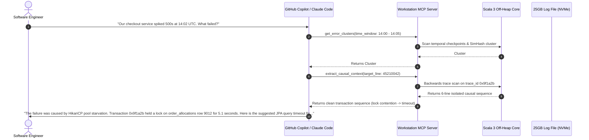

# Model Context Protocol (MCP) Server & External Agent Ecosystem

---

## Table of Contents
- [1. Overview & Context Window Constraints](#1-overview--context-window-constraints)
- [2. MCP Server Configuration & Client Setup](#2-mcp-server-configuration--client-setup)
  - [2.1 Workstation In-App Settings](#21-workstation-in-app-settings-ctrl)
  - [2.2 Client Configuration Examples](#22-client-configuration-examples)
- [3. Exposed MCP Tool Specifications](#3-exposed-mcp-tool-specifications)
  - [3.1 search_logs](#31-search_logs)
  - [3.2 extract_causal_context](#32-extract_causal_context)
  - [3.3 get_error_clusters](#33-get_error_clusters)
  - [3.4 get_time_slice](#34-get_time_slice)
  - [3.5 trim_and_export](#35-trim_and_export)
- [4. End-to-End Agent Interaction Trace](#4-end-to-end-agent-interaction-trace)

---

## 1. Overview & Context Window Constraints

AI coding assistants (GitHub Copilot, OpenAI Codex, Claude Code, Cursor, Antigravity) are constrained by context window limits ($128\text{K} - 1\text{M}$ tokens). 
- A **25GB log file** contains roughly **5 Billion tokens**.
- An external coding agent cannot open, read, or grep this file directly without exhausting its context window, timing out, or incurring high API token costs.

```
┌─────────────────────────────────────────────────────────────────────────────┐
│                   EXTERNAL AI AGENTS & CLIENT WORKSTATIONS                  │
│   (GitHub Copilot, Claude Code, Cursor, OpenAI Codex, Antigravity IDE)      │
└──────────────────────────────────────▲──────────────────────────────────────┘
                                       │ Standard Model Context Protocol (MCP)
                                       │ JSON-RPC 2.0 over stdio or SSE / HTTP
┌──────────────────────────────────────▼──────────────────────────────────────┐
│                    EMBEDDED WORKSTATION MCP SERVER                          │
│                                                                             │
│  ┌─────────────────────────────────┐   ┌──────────────────────────────────┐ │
│  │ Fast Tool Execution Layer       │   │ High-Precision Forensics Engine  │ │
│  │ - search_logs (SIMD 25 GB/s)    │   │ - extract_causal_context         │ │
│  │ - get_time_slice (temporal seek)│   │ - get_error_clusters (SimHash)   │ │
│  │ - trim_and_export (zero-copy)   │   │ - get_log_metrics & rate spikes  │ │
│  └─────────────────────────────────┘   └──────────────────────────────────┘ │
└──────────────────────────────────────▲──────────────────────────────────────┘
                                       │ Direct Zero-Copy Query Bridge
                                       │ (Off-Heap Scala 3 Core Engine)
┌──────────────────────────────────────▼──────────────────────────────────────┐
│           HIGH-THROUGHPUT ENGINE MEMORY MAPPING (25GB - 100GB+)             │
└─────────────────────────────────────────────────────────────────────────────┘
```

By embedding a native **Model Context Protocol (MCP)** server directly inside the workstation, external agents gain real-time, hardware-accelerated access to multi-gigabyte logs as an **external cognitive tool**. The agent queries the MCP server, and the engine searches 25GB in $<200\text{ ms}$, returning only the targeted 20 lines of causal context!

---

## 2. MCP Server Configuration & Client Setup

The workstation exposes standard MCP interfaces via:
1. **Embedded HTTP / SSE Loopback Transport:** Listens on `http://127.0.0.1:4242/mcp` (configurable port in Settings).
2. **`stdio` Transport:** Spawned as a CLI sub-process (e.g. `umbrix mcp-server /var/log/app.log`).

### 2.1 Workstation In-App Settings (`Ctrl+,`)
Configure both the embedded server and the local/remote LLM engine in the **Settings Dialog**:
1. Open Settings (`Ctrl+,` or Hamburger `☰` $\to$ **Settings...**).
2. Navigate to **`🤖 AI & MCP Connections`**:
   - **Embedded MCP Server:** Toggle HTTP server and configure loopback port (default `4242`).
   - **AI Engine Provider:** Select preset (`Ollama (Local)`, `OpenAI Compatible`, or `Custom MCP`).
   - **Endpoint URL:** e.g., `http://localhost:11434` or `https://api.openai.com`.
   - **Model Name:** e.g., `llama3.2` or `gpt-4o-mini`.
   - **API Key:** Optional for local Ollama / LM Studio; API key for remote providers.

### 2.2 Client Configuration Examples

#### Cursor (`.cursor/mcp.json` or Settings $\to$ Features $\to$ MCP)
```json
{
  "mcpServers": {
    "umbrix": {
      "url": "http://127.0.0.1:4242/mcp"
    }
  }
}
```

#### Google Antigravity (AGY) (`.gemini/mcp.json` or `~/.gemini/antigravity/mcp.json`)
```json
{
  "mcpServers": {
    "umbrix": {
      "url": "http://127.0.0.1:4242/mcp"
    }
  }
}
```

#### Claude Desktop (`claude_desktop_config.json`)
- Windows: `%APPDATA%\Claude\claude_desktop_config.json`
- macOS: `~/Library/Application Support/Claude/claude_desktop_config.json`
```json
{
  "mcpServers": {
    "umbrix": {
      "url": "http://127.0.0.1:4242/mcp"
    }
  }
}
```

#### Claude Code (CLI)
```bash
claude mcp add --transport http umbrix http://127.0.0.1:4242/mcp
```

#### Sub-process / CLI Stdio Fallback
```json
{
  "mcpServers": {
    "umbrix": {
      "command": "umbrix",
      "args": [
        "mcp",
        "--active-session"
      ]
    }
  }
}
```

---

## 3. Exposed MCP Tool Specifications

### 3.1 `search_logs`
Executes hardware-accelerated SIMD substring, RE2 linear-time regex, or boolean search across active multi-gigabyte log sessions.

```json
{
  "name": "search_logs",
  "description": "Performs high-speed SIMD vector search over active 20GB+ logs. Returns line numbers, timestamps, and line content.",
  "inputSchema": {
    "type": "object",
    "properties": {
      "query": {
        "type": "string",
        "description": "Search pattern (literal substring, RE2 regex, or boolean DSL: level:ERROR AND NOT healthcheck)"
      },
      "start_time": {
        "type": "string",
        "description": "ISO-8601 timestamp window start (e.g. 2026-09-21T14:00:00Z)"
      },
      "end_time": {
        "type": "string",
        "description": "ISO-8601 timestamp window end (e.g. 2026-09-21T14:05:00Z)"
      },
      "log_level": {
        "type": "string",
        "enum": ["ALL", "FATAL", "ERROR", "WARN", "INFO", "DEBUG"]
      },
      "max_results": {
        "type": "integer",
        "default": 50
      }
    },
    "required": ["query"]
  }
}
```

---

### 3.2 `extract_causal_context`
Extracts the pure causal timeline for a given transaction or thread, completely stripping away interleaved concurrent log statements.

```json
{
  "name": "extract_causal_context",
  "description": "Isolates the unbroken causal thread of execution for a failure point by filtering on correlation trace_id or thread name.",
  "inputSchema": {
    "type": "object",
    "properties": {
      "target_line": {
        "type": "integer",
        "description": "The line index of the error or failure point"
      },
      "trace_id": {
        "type": "string",
        "description": "Optional explicit correlation trace ID (e.g. 0x9f1a2b)"
      },
      "backward_lookahead_lines": {
        "type": "integer",
        "default": 5000,
        "description": "Window of lines to scan backwards for causal origin"
      }
    },
    "required": ["target_line"]
  }
}
```

---

### 3.3 `get_error_clusters`
Returns canonical error equivalence classes across the entire 25GB file, computed off-heap via 64-bit SimHash.

```json
{
  "name": "get_error_clusters",
  "description": "Groups thousands of repetitive exceptions into canonical root-cause clusters with frequency metrics and representative exemplars.",
  "inputSchema": {
    "type": "object",
    "properties": {
      "max_clusters": {
        "type": "integer",
        "default": 5
      },
      "time_window_start": {
        "type": "string"
      },
      "time_window_end": {
        "type": "string"
      }
    }
  }
}
```

---

### 3.4 `get_time_slice`
Retrieves log records between two wall-clock timestamps via the off-heap temporal checkpoint binary search table ($O(\log N)$).

```json
{
  "name": "get_time_slice",
  "description": "Fetches a slice of log records between two ISO-8601 timestamps without scanning the entire file.",
  "inputSchema": {
    "type": "object",
    "properties": {
      "start_time": {
        "type": "string",
        "description": "ISO-8601 start timestamp"
      },
      "end_time": {
        "type": "string",
        "description": "ISO-8601 end timestamp"
      },
      "limit": {
        "type": "integer",
        "default": 100
      }
    },
    "required": ["start_time", "end_time"]
  }
}
```

---

### 3.5 `trim_and_export`
Executes zero-copy kernel slicing to export an exact subset of the 25GB log to disk for forensic archiving or sharing.

```json
{
  "name": "trim_and_export",
  "description": "Extracts and exports a specific time range or line slice to a new file using zero-copy OS kernel primitives (sendfile/clonefile).",
  "inputSchema": {
    "type": "object",
    "properties": {
      "output_path": {
        "type": "string",
        "description": "Destination file path"
      },
      "start_line": {
        "type": "integer"
      },
      "end_line": {
        "type": "integer"
      },
      "start_time": {
        "type": "string"
      },
      "end_time": {
        "type": "string"
      },
      "sanitize_pii": {
        "type": "boolean",
        "default": true,
        "description": "Automatically redacts passwords, tokens, and PII in exported slice"
      }
    },
    "required": ["output_path"]
  }
}
```

---

## 4. End-to-End Agent Interaction Trace



By offloading all indexing, search, clustering, and data slicing to the native workstation, the AI agent consumes **less than 1,500 tokens total** to diagnose an incident hidden inside a **25 Gigabyte file**!
