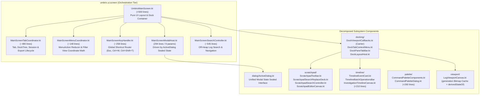

# Umbrix UI Architecture & Viewport Virtualization

> **Subsystem Mission:** Deliver hardware-accelerated 60–120 FPS desktop rendering across **25GB – 100GB+ log files** ($>2\cdot 10^8$ lines) with authentic IntelliJ "New UI" dark carbon aesthetics, sub-millisecond line navigation, and zero bytes of log data ingested into the JVM Garbage Collector heap.

---

## Table of Contents
- [1. Architectural Topology & Component Hierarchy](#1-architectural-topology--component-hierarchy)
- [2. 64-Bit Viewport Virtualization Math](#2-64-bit-viewport-virtualization-math)
  - [Sliding Window Viewport Model](#sliding-window-viewport-model)
  - [Drag Selection and Edge Scrolling](#drag-selection-and-touchslop-gated-edge-scrolling)
  - [Coordinate Synchronization Across Tri-Mode Views](#coordinate-synchronization-across-tri-mode-views)
  - [64-Bit Custom Scrollbar](#64-bit-custom-scrollbar-custom64bitscrollbar)
- [3. Tri-Mode Viewport Layout & Safety Clamping](#3-tri-mode-viewport-layout--safety-clamping)
- [4. Semantic Theming & Dynamic Theme Engine Architecture](#4-semantic-theming--dynamic-theme-engine-architecture)
  - [Core Token Categories (81 Tokens)](#core-token-categories-81-tokens)
  - [Hardware Typography Fallback](#hardware-typography-fallback-editortypography)
- [5. Interaction Patterns, Shortcuts & Navigation](#5-interaction-patterns-shortcuts--navigation)
  - [Global Keyboard Routing](#global-keyboard-routing-workstationkeydispatcher)
  - [Custom Integrated Window Title Bar](#custom-integrated-window-title-bar-integratedtitlebar)
  - [Dual-Mode Go-to-Line & Timestamp Jump](#dual-mode-go-to-line--timestamp-jump-gototimestampdialog)
  - [Partial Text Drag Selection & Hit-Testing](#partial-text-drag-selection-exact-textlayoutresult-hit-testing--i-beam-cursor)
  - [Kinetic Scrolling & Hardware-Clipped Partial Lines](#smooth-intra-line-kinetic-scrolling--hardware-clipped-partial-lines)
  - [Decluttered Single-Row Search Bar](#decluttered-single-row-search-bar-with-sublimeintellij-modes-searchbar)
  - [GPU Seismograph Minimap Scrubber](#gpu-seismograph-minimap-scrubber--anomaly-navigation-gpuseismographminimap)
- [6. Real-Time Telemetry & Progress Invariants](#6-real-time-telemetry--progress-invariants)
  - [Decluttered Status Bar](#decluttered-status-bar-with-right-click-context-menu-bottomstatusbar)
  - [Desktop Window Sizing & Indexing Indicator](#desktop-window-sizing)
- [7. UI/UX Overhaul Specifications](#7-complete-uiux-overhaul-specifications-phase-10)
  - [7.1 Unified Action & Selection Deck](#71-unified-action--selection-deck)
  - [7.2 Modal Dialog Polish & Design Language](#72-modal-dialog-polish--design-language)
  - [7.3 Modular UI & Multi-Pane Docking Subsystem](#75-modular-ui--multi-pane-docking-subsystem-umbrixuidocking)
  - [7.4 Unified In-Scratchpad & Workstation Search](#76-unified-in-scratchpad--workstation-search-mainscreensearchcontroller-scratchpadeditorcanvas)
  - [7.8 Responsive Layout, Wrapping & Sizing Architecture](#78-responsive-layout-wrapping--sizing-architecture)

---

## 1. Architectural Topology & Component Hierarchy

The `:umbrix-ui` subsystem is built with **Kotlin Multiplatform (Desktop)**, **JetBrains Compose Desktop 1.7.3**, **JetBrains Jewel 0.27 (IntelliJ New UI)**, and hardware-accelerated **Skiko/Skia** rendering (DirectX 12 / Metal / Vulkan).

To uphold the zero-God-object invariant, the presentation tier is decomposed into fine-grained, single-responsibility components:

```
umbrix-ui/src/main/kotlin/umbrix/ui/
├── bookmarks/                   # Gutter bookmarks & bookmark manager
│   ├── BookmarkManager.kt       # Bookmark state coordinator & F2/Shift+F2 navigation
│   ├── BookmarkManagerDialog.kt # Modal dialog with bookmark search & note editing
│   └── BookmarkModel.kt         # Immutable Bookmark model
├── components/
│   ├── Badge.kt                 # Reusable styled status badge chip with maxWidth & single-line ellipsis
│   ├── ForensicErrorBanner.kt   # Collapsible diagnostic error banner with clipboard export
│   └── SingleLinePrimitives.kt  # Ellipsis & single-line enforcement primitives (SingleLineText)
├── contextmenu/
│   └── LogViewportContextMenu.kt # Right-click row context menu (copy, filter, seek, export)
├── dialog/
│   ├── AboutDialog.kt           # Workstation telemetry modal (SIMD width, FFM, JDK info)
│   ├── ActiveDialog.kt          # Sealed interface model for modal dialog states
│   ├── ExportSubFileDialog.kt   # DMA sub-file slicing dialog with size estimations
│   ├── GoToTimestampDialog.kt   # Dual-mode modal overlay (Ctrl+G) supporting line jumps & wall-clock queries
│   ├── KeyboardShortcutsDialog.kt # Searchable keybindings cheatsheet modal
│   ├── RenameScratchpadDialog.kt # Scratchpad tab renaming modal
│   └── SettingsDialog.kt        # IntelliJ-style settings modal (Appearance, Fonts, View, Languages, Performance, AI/MCP, Plugins)
├── docking/                     # Modular multi-pane docking subsystem
│   ├── DetachedWindowManager.kt # Popped-out secondary desktop OS windows (DetachedWindowsHost)
│   ├── DockDragCoordinator.kt   # Drag hit testing against pane & tab bar bounds
│   ├── DockDropZone.kt          # Center/edge drop zone enum
│   ├── DockGhostOverlay.kt      # Animated translucent blue drop outline & action chips
│   ├── DockLayoutHost.kt        # Root docking host rendering binary split trees
│   ├── DockNode.kt              # Recursive binary tree (Leaf & Split) data models
│   ├── DockOrientation.kt       # Horizontal / Vertical split enum
│   ├── DockPaneTabBar.kt        # Per-pane tab bar with dragging, close & split controls
│   ├── DockPaneView.kt          # Pane container hosting logs or scratchpads
│   ├── DockSplitDivider.kt      # 7dp draggable divider with synchronized scroll toggle (⇋)
│   ├── DockTabContextMenu.kt    # Tab right-click and '+' new-tab context dropdown menus
│   ├── DockTreeManager.kt       # Pure tree mutations (split, remove, move, collapse, equalize)
│   └── DockViewportCallbacks.kt # Immutable callback carrier collapsing recursive split tree prop-drilling
├── error/
│   └── WorkstationErrorHandler.kt # Uncaught exception handler, fatal error safety guard
├── header/
│   └── IntegratedTitleBar.kt    # Custom borderless title bar (logo, hamburger menu host, draggable area, controls)
├── icon/
│   └── UmbrixIcon.kt            # Multi-resolution icon loader, 100% full-bleed squircle rasters, taskbar & window icons
├── launcher/
│   └── DesktopAppLauncher.kt    # Composition root, window creation, DnD listener & MenuAction channel
├── menu/                        # Compose-native cascading hamburger menu
│   ├── MenuActions.kt           # sealed MenuAction contract + ViewToggle enum
│   ├── MenuSettingsReducer.kt   # Pure reducer: settings-scoped actions -> WorkstationSettings
│   ├── MenuGeometry.kt          # Root/submenu placement math + PopupPositionProviders (edge flip/clamp)
│   ├── UmbrixDropdownMenu.kt    # Focusable root popup, MenuPanel surface, MenuLevelState hover debounce
│   ├── UmbrixMenuItem.kt        # 32dp row: check/radio/glyph, label, shortcut, cascade arrow
│   ├── UmbrixMenuSeparator.kt   # 1dp hairline divider
│   ├── UmbrixSubMenu.kt         # 200ms hover-debounced non-focusable cascade
│   └── HamburgerMenuContent.kt  # Declarative menu tree bound to WorkstationSettings & ThemeRegistry
├── palette/                     # Universal multi-persona command palette
│   ├── CommandPaletteComponents.kt # Header, category pills, Vim status banner, result row & footer
│   ├── CommandPaletteDialog.kt  # Omni / VS Code / IntelliJ / Vim modal prompt
│   ├── CommandRegistry.kt       # 50+ actions indexing tabs, themes, recent files, tools
│   ├── FuzzyMatcher.kt          # O(N) linear-time fuzzy subsequence matching
│   ├── PaletteCommand.kt        # Command definitions and category tagging
│   └── VimExCommandParser.kt    # Vim ':' command parser (:w, :q, :theme, :1234)
├── scratchpad/                  # In-app scratchpad text editor
│   ├── ScratchpadEditorCanvas.kt # Themed editor canvas with gutters, syntax coloring & search
│   ├── ScratchpadManager.kt     # Multi-scratchpad lifecycle, dirty state & disk persistence
│   ├── ScratchpadManagerDialog.kt # Scratchpad overview and management modal
│   ├── ScratchpadModel.kt       # Immutable scratchpad state
│   ├── ScratchpadSearchController.kt # Pure scratchpad in-memory search and navigation controller
│   ├── ScratchpadSearchReplaceDeck.kt # Find & Replace deck with case/regex toggles and match navigator
│   └── ScratchpadToolbar.kt     # Top action bar with dirty indicators, line counter and native save dialog
├── screen/
│   ├── MainScreenKeyHandler.kt  # Global window-level keyboard shortcut router (Esc, Ctrl+W, Ctrl+Shift+T, Vim)
│   ├── MainScreenMenuCoordinator.kt # Menu action reducer, filter view toggles and coordinate math
│   ├── MainScreenModalHost.kt   # Unified modal host driven by ActiveDialog sealed state
│   ├── MainScreenSearchController.kt # Search coordinator & bi-directional scratchpad/log search
│   ├── MainScreenTabCoordinator.kt # Tab lifecycle, dock tree mutations, session management & exports
│   ├── UmbrixMainScreen.kt      # Main workstation orchestrator (<500 lines)
│   └── WelcomeScreen.kt         # Zero-tab welcome dashboard with recent files & quick actions
├── search/
│   ├── SearchBar.kt             # Jewel search toolbar with filter toggle & export
│   └── SearchHighlighter.kt     # Multi-needle span highlighter & 512-entry LRU cache
├── selection/
│   └── TextSelectionState.kt    # Mouse drag text selection state & character offset translation
├── settings/
│   ├── SettingsManager.kt       # Persistent JSON settings manager (~/.umbrix/settings.json)
│   ├── ViewportLayoutMode.kt    # Compact / Expandable / Full Wrap mode enum
│   └── WorkstationSettings.kt   # Reactive data classes for UI preferences & recent files
├── state/
│   ├── WorkspaceTab.kt          # Reactive tab container (session, query, selection, minimap)
│   └── WorkstationKeyDispatcher.kt # Window-level shortcut router (Ctrl+F, Ctrl+G, Ctrl+C, Ctrl+,, Esc)
├── temporal/
│   └── TemporalRangeScrubber.kt # Dual-handle horizontal time slider with latency ticks & focus trimming
├── theme/
│   ├── EditorTypography.kt      # Cross-platform monospace font fallback chain
│   ├── ThemeRegistry.kt         # 10 built-in theme presets lookup & metadata
│   └── UmbrixTheme.kt           # Centralized semantic tokens & CompositionLocal provider
├── timeline/                    # Cross-file forensic incident timeline
│   ├── IncidentReportExporter.kt # Markdown post-mortem, raw log stream & JSON export
│   ├── InvestigationTimelineCanvas.kt # Dockable tab canvas with event filters & line jumps (<210 lines)
│   ├── InvestigationTimelineManager.kt # Multi-document event pinning & delta-t calculation
│   ├── TimelineEventCard.kt     # Event cards with causal notes, tag switcher & multi-row batch operations bar
│   ├── TimelineExportDialog.kt  # Incident export configuration dialog
│   └── TimelineModel.kt         # Incident event definitions and tags
├── toast/                       # Floating non-blocking toast notifications
│   ├── ToastHost.kt             # Overlay container with animated entrance/exit
│   ├── ToastManager.kt          # Toast lifecycle, deduplication & auto-dismiss timers
│   └── ToastModel.kt            # Toast models and semantic variants
├── toolbar/
│   └── BottomStatusBar.kt       # Index/document telemetry, JVM memory & indexing progress
├── util/
│   └── FormatUtils.kt           # Number formatting & native file dialog wrappers
└── viewport/
    ├── Custom64BitScrollbar.kt  # 64-bit integer scrollbar with sub-pixel drag tracking
    ├── GpuSeismographMinimap.kt # Skia GPU density canvas, multi-channel severity layers & scrubber
    ├── LogViewportCanvas.kt     # Main log viewport canvas orchestrator (64-bit scroller, layout container)
    ├── SelectionEdgeScroll.kt   # Bounded edge velocity and 64-bit row scrolling calculations
    ├── ViewportGestureHandler.kt # Single-click, multi-click, drag selection & touchSlop-gated edge scrolling
    ├── ViewportGutter.kt        # Virtualized line number gutter and breakpoint markers
    ├── ViewportTextRow.kt       # Isolated monospaced text row with syntax highlight and chevron expansion
    └── Virtual64Viewport.kt     # Clamping and virtual layout state
```

### Workstation Orchestration & Coordinator Architecture

To eliminate monolithic God-components, `UmbrixMainScreen` delegates orchestration across decoupled, single-responsibility coordinators:



- **`ActiveDialog` Sealed Hierarchy:** Mutually-exclusive modal dialogs (`GoToLineTimestamp`, `Settings`, `About`, `KeyboardShortcuts`, `ExportSubFile`, `CommandPalette`, `ScratchpadManager`, `BookmarkManager`, `TimelineExport`, `RenameScratchpad`, `None`) replace 38+ individual boolean flags.
- **`DockViewportCallbacks` Prop-Drilling Elimination:** An `@Immutable` callback carrier carries all pane, tab, scratchpad, search, timeline, and export actions across the recursive binary split tree (`DockLayoutHost` $\to$ `DockPaneView` $\to$ `DockPaneTabBar`).
- **Zero-Allocation Scroll Performance:** `BookmarkManager.generation` tracks bookmark mutations; `LogViewportCanvas` memoizes bitmaps on `generation` rather than calling `.bookmarks.toList()` on kinetic scroll frames. Row composables are wrapped in `key(physicalLine, rowIndex)` to enable Compose smart-recomposition skipping during sub-pixel scrolling.

---

## 2. 64-Bit Viewport Virtualization Math

Standard UI list virtualizers (such as Compose `LazyColumn`) fail catastrophically when line counts exceed $10^7$:

1. **`Int32` Layout Overflow:** At a row height of $20\text{ px}$, virtual canvas heights reach `Int.MAX_VALUE` ($2,147,483,647$) at just **$107,374,182$ lines**, causing negative layout sizes, integer overflow, and immediate crashes.
2. **Float Scrollbar Jitter:** Standard scrollbars use 32-bit `Float` ($24\text{-bit}$ significand = $16,777,216$ discrete steps). In a 200M-line log, a single float step jumps $\approx 12$ lines, causing violent visual stuttering.
3. **Skia Matrix Underflow:** Placing items at global coordinate $Y = 50,000,000 \times 20\text{ px} = 1,000,000,000\text{ px}$ degrades Skia's internal single-precision floating-point matrices, resulting in clipped glyphs and text distortion.

### Sliding Window Viewport Model
Umbrix completely bypasses `LazyColumn`, replacing it with a localized sliding window anchored at local screen coordinates $(0, 0)$:

$$\text{Viewport State} = \left\langle L_{\text{top}} \in [0, N - 1], \; \Delta y \in [0.0, h_{\text{line}}) \right\rangle$$

- $L_{\text{top}}$ is a 64-bit `Long` representing the top visible physical or virtual line index.
- $\Delta y$ is a sub-pixel `Float` offset representing intra-line kinetic scroll displacement.
- The Skia canvas **never translates past one row height**. All rows are positioned strictly within $[ -h_{\text{line}}, H_{\text{viewport}} + h_{\text{line}} ]$.

### Drag Selection and TouchSlop-Gated Edge Scrolling
- Pointer gesture handling is isolated in `ViewportGestureHandler.kt`.
- **Zero Horizontal Drift on Stationary Click:** To prevent Compose's `BringIntoViewRequester` from shifting `horizontalScrollState` by 8dp on click, row items avoid `Modifier.clickable`. Instead, `ViewportGestureHandler` records clicks and only initiates selection and edge-scrolling jobs if pointer movement strictly exceeds Compose's `viewConfiguration.touchSlop`.
- **Edge Velocity Scroll Gate:** Hovering within 48 pixels of a horizontal or vertical edge during an active drag (`moved == true`) advances the scroll axis on animation frames. Edge scrolling is strictly inhibited on stationary pointer presses so clicking near the left gutter never scrolls horizontally.
- **Stationary Click Selection:** Upon pointer release without drag movement (`!moved && released`), stationary clicks cleanly set `tab.selectedLineIndex = clickedPhysicalLine` and clear transient character selection boxes.
- As in desktop text editors, a primary-button double-click replaces any prior highlight with the word under the pointer; a nearby third click replaces it with the entire displayed log line. Double/triple-click drags extend by whole words/lines in either direction, including at viewport edges; a single-click drag remains character-based.
- Selection coordinates are virtual rows. `Ctrl/Cmd+C` maps filtered rows through `FilteredLineView` and temporal rows through their focus-start offset before reading at most 4,096 characters per row. Word and line clicks copy exactly the highlight without a trailing newline.

### Coordinate Synchronization Across Tri-Mode Views
1. **Full View:** $L_{\text{top}}$ and `selectedLineIndex` are absolute 0-based document physical lines.
2. **Temporal Slice Mode:** $L_{\text{top}}$ is a relative offset $[0, \text{endLine} - \text{startLine}]$, while `selectedLineIndex` remains the absolute physical line number. View bounds and relative scroll positions convert via pure arithmetic:
   $$\text{physicalLine} = \text{temporalStartLine} + \text{virtualRow}$$
3. **Filtered Search / Bookmark View:** $L_{\text{top}}$ is a 0-based virtual index $[0, \text{totalFilteredLines} - 1]$, mapped to physical lines in $O(1)$ time via `FilteredLineView.physicalLineForVirtualIndex(v)`. Toggling filtered view translates physical anchor lines into virtual ranks and vice-versa, preserving the active cursor without jumping to line 0.

### 64-Bit Custom Scrollbar (`Custom64BitScrollbar`)
- Scroll progress uses 64-bit integer arithmetic:
  $$\text{scrollProgress} = \frac{L_{\text{top}}}{\max(1, N - V_{\text{visible}})}$$
- Thumb offset: $\text{thumbY} = \text{scrollProgress} \times (\text{trackHeight} - \text{thumbHeight})$.
- Dragging uses fractional line accumulation (`lineDeltaAccumulator += dragDeltaY * (maxTopLine / scrollableTrack)`), converting fractional drag distances to integer line jumps without loss of precision.

### Viewport Scrolling Zero-Allocation Architecture
To ensure 60–120 FPS kinetic scrolling without garbage collection stutter or heap expansion across multi-gigabyte log files ($>2 \cdot 10^8$ lines):
1. **Recomposition Scope Isolation:**
   - `UmbrixMainScreen` root composable does not read `currentTab.topVisibleLine`. The scroll coordinate is observed strictly within the localized `BottomStatusBar` composition scope, completely isolating window chrome, dock splits, and dialog hosts from 60 FPS scroll recomposition.
2. **Monospace Constant-Advance Character Width:**
   - In monospace fonts, glyph width is fixed. Character width is measured once via `rememberTextMeasurer()` on font/size updates (`measuredCharWidthPx`) and assigned directly to `dynamicCharWidthPx` as an immutable Float, eliminating layout invalidation feedback loops from `onTextLayoutResult`.
3. **Row Callback Memoization:**
   - Event callbacks (`onContextMenuOpen`, `onClearFocus`, `onTextLayoutResult`, `onScrollToLine`) are wrapped in `remember` instances, enabling Compose to skip recomposition for unchanged viewport rows.
4. **Hoisted Interaction Sources:**
   - `MutableInteractionSource` instances in `ViewportGutter` are hoisted outside the row loop, avoiding 52 slot table entry allocations per frame.
5. **Zero-Heap Event Classifier Fallback:**
   - Fallback `EventBoundaryClassifier` instances share a static empty bitmap (`EmptyContinuationBitmap`), and `LogSession` caches `lazy val fallbackClassifier`, preventing thousands of `Roaring64NavigableMap` object allocations during active viewport scrolling prior to Tier 2 completion. Heap footprint remains strictly flat (<30MB) across rapid scrubbing.

---

## 3. Tri-Mode Viewport Layout & Safety Clamping

To support diverse enterprise workloads without sacrificing smooth 60–120 FPS scrolling:

| Mode | Coordinate Translation | Characteristics | Target Use Case |
| :--- | :--- | :--- | :--- |
| **Mode 1: Compact Fixed Mode** | Strict $O(1)$ math | Strict 20px rows, horizontal scrolling, auxiliary detail drawer | Maximum throughput (60–120 FPS) across 200M+ lines |
| **Mode 2: Expandable Mode (Default)** | Sparse binary search $O(\log k)$ | Base 20px rows with drop-down chevrons `[⯈]` for stack traces / JSON | Standard workstation view; extra heights tracked in `Long2IntOpenHashMap` |
| **Mode 3: Full Wrap Mode** | Sliding-window LRU layout | Multi-line text wrapping to viewport width | Deep log inspection on wide monitors |

### Safety Clamping Invariant
Any single line exceeding **4,096 characters** is strictly clamped:
$$\text{displayChars} = \min(\text{rawChars}, 4096)$$
This guarantees that Skia font shaping (HarfBuzz/ICU) is never exhausted by malformed or single-line 20MB minified JSON payloads.

---

## 4. Semantic Theming & Dynamic Theme Engine Architecture

All visual styling is standardized through the **`UmbrixThemeSpec`** interface contract (81 semantic tokens across 11 functional categories) provided down the Compose hierarchy via `LocalUmbrixTheme`. Raw `Color(0x...)` literals are strictly prohibited inside individual UI composables.

```kotlin
// In umbrix.ui.theme:
val LocalUmbrixTheme = staticCompositionLocalOf<UmbrixThemeSpec> { DarkCarbonTheme }

object UmbrixTheme {
    val colors: UmbrixThemeSpec
        @Composable
        @ReadOnlyComposable
        get() = LocalUmbrixTheme.current
}
```

UI composables consume semantic tokens dynamically:

```kotlin
// Example usage across workstation components:
Box(modifier = Modifier.background(UmbrixTheme.colors.surface)) {
    Text(
        text = "Umbrix Workstation",
        color = UmbrixTheme.colors.textPrimary
    )
}
```

### Core Token Categories (81 Tokens)
1. **Window & Chrome (6):** `surfaceWindow`, `surfaceChrome`, `surfacePanel`, `surfaceElevated`, `surfaceOverlay`, `borderDefault`.
2. **Navigation & Tabs (6):** `tabActiveBackground`, `tabInactiveBackground`, `tabHoverBackground`, `tabActiveText`, `tabInactiveText`, `tabActiveIndicator`.
3. **Typography (7):** `textPrimary`, `textSecondary`, `textMuted`, `textDimmed`, `textInverse`, `textEditor`, `textLink`.
4. **Gutter (6):** `gutterBackground`, `gutterLineNormal`, `gutterLineSelected`, `gutterLineActiveMatch`, `gutterLineMatch`, `gutterBorder`.
5. **Row Highlights & Search Needles (9):** `rowSelected`, `rowActiveMatch`, `rowMatch`, `rowFilteredMatch`, `searchHighlightActive`, `searchHighlightInactive`, `searchTextActive`, `searchTextInactive`, `selectionBackground`.
6. **Forensic Severity Indicators (5):** `severityError`, `severityWarn`, `severityInfo`, `severityDebug`, `severityTrace`.
7. **Progress & Badges (12):** `progressGradientStart`, `progressGradientEnd`, `progressTrack`, `badgeSuccessBackground`, `badgeSuccessText`, `badgeWarningBackground`, `badgeWarningText`, `badgeErrorBackground`, `badgeErrorText`, `badgeInfoBackground`, `badgeInfoText`, `badgeSecondaryBackground`.
8. **Minimap & Seismograph (7):** `minimapBackground`, `minimapError`, `minimapWarn`, `minimapInfo`, `minimapMatch`, `minimapViewportIndicator`, `minimapFocusOverlay`.
9. **Temporal Range Scrubber (9):** `scrubberBackground`, `scrubberTrack`, `scrubberSelectedRange`, `scrubberHandle`, `scrubberHandleHover`, `scrubberHandleDragging`, `scrubberLatencyGapWarning`, `scrubberLatencyGapSevere`, `scrubberTick`.
10. **Interactive Controls (7):** `buttonPrimaryBackground`, `buttonPrimaryText`, `buttonSecondaryBackground`, `buttonSecondaryText`, `controlHoverBackground`, `controlActiveBackground`, `controlBorder`.
11. **Dialogs & Flyouts (7):** `dialogBackground`, `dialogBorder`, `dialogScrim`, `dialogHeaderBackground`, `dialogSectionHeader`, `fieldBackground`, `fieldBorder`.

### Hardware Typography Fallback (`EditorTypography`)
The workstation resolves crisp hardware-accelerated monospace font rendering across all host OS platforms:
$$\text{JetBrains Mono} \to \text{Cascadia Code} \to \text{Consolas} \to \text{SF Mono} \to \text{Menlo} \to \text{Monaco} \to \text{DejaVu Sans Mono}$$

---

## 5. Interaction Patterns, Shortcuts & Navigation

### Global Keyboard Routing (`WorkstationKeyDispatcher`)
Window preview key events intercept at the root level before child focus traps:

| Shortcut | Action | Scope / Context |
| :--- | :--- | :--- |
| **`Ctrl+F` / `Cmd+F`** | Toggle Search Bar & focus query input | Global |
| **`Ctrl+G` / `Cmd+G`** | Open Go-to-Line modal dialog | Active log document |
| **`Ctrl+,` / `Cmd+,`** | Open Settings modal dialog (IntelliJ-style) | Global |
| **`Ctrl+C` / `Cmd+C`** | Copy selected text snippet or row to clipboard | Viewport selection (falls through to TextField copy if editing) |
| **`F3`** | Navigate to next search match | Global |
| **`Shift+F3`** | Navigate to previous search match | Global |
| **`Enter` / `Shift+Enter`** | Navigate next / previous search match | Scoped to Search Bar `TextField` |
| **`Escape`** | Hierarchical dismissal: Close dialog $\to$ Close search bar $\to$ Clear text/row selection | Global |

### Custom Integrated Window Title Bar (`IntegratedTitleBar`)
- Borderless frame (`undecorated = true`) with a 1px `UmbrixColors.surfaceElevated` border.
- Custom window draggable area (`WindowDraggableArea`), allowing the window to be dragged across screens without white OS decoration bars.
- Branding lockup with custom Umbrix gradient logo, file name display, hamburger settings menu (`☰`), and window controls (minimize, maximize/restore, close).

### Dual-Mode Go-to-Line & Timestamp Jump (`GoToTimestampDialog`)
- Unified modal overlay (`Ctrl+G` / `Cmd+G`) driven by `ActiveDialog.GoToLineTimestamp`.
- **Dual-Mode Operation:** Instant switching between direct 1-based line number seeking and wall-clock timestamp/temporal navigation.
- Displays valid range bounds (`1 – $totalLines`) and detected file epoch bounds.
- Clamped input validation preventing `NumberFormatException` or out-of-bounds seeks.
- Seeking executes via Two-Level Sparse Index arithmetic in $<1.5\ \mu\text{s}$.

### Partial Text Drag Selection, Exact TextLayoutResult Hit-Testing & I-Beam Cursor
- Mouse click-and-drag across the log viewport tracks start and end character offsets (`TextSelectionState`), supporting horizontal and multi-line snippet selection.
- **I-Beam Selection Cursor:** Hovering over the monospaced log text viewport displays the standard desktop text selection cursor (`PointerIcon(Cursor.TEXT_CURSOR)`).
- **Exact Skia Layout Hit-Testing via LayoutCoordinates:** Rather than relying on speculative font advance heuristics or manual pixel math, `LogViewportCanvas` captures the viewport's `LayoutCoordinates` and queries the live `RowTextLayout(virtualRow, physicalLine, layout, coordinates)`. During mouse clicks and drag selections, `textCoordinates.localPositionOf(viewportCoordinates, pointerPosition)` maps pointer offsets directly into row text space, and `layout.getOffsetForPosition` queries Skia's HarfBuzz text shaping engine directly, yielding 100% exact 1:1 character index resolution across Compact, Expandable, and Full Wrap modes.
- **Variable-Height Row Hit-Testing:** The target row is resolved by `resolveRowAtPointer` from live row top edges in viewport coordinates (not `y / rowHeightPx`), so wrapped Full Wrap rows and expanded stack traces select under the cursor; fixed-height math is only a fallback for unattached coordinates. In Full Wrap the intra-row Y is clamped to the row layout height. The gutter currently keeps fixed-height line-number boxes (misaligned past wrapped rows).
- Coordinate transformation accounts automatically for horizontal scroll, graphicsLayer vertical sub-line translation, text padding (`8.dp`), and multi-line continuation chevrons without manual drift or double-counting.
- Selected character ranges are rendered with a visual highlight overlay (`UmbrixColors.rowSelected`).
- When text is selected, `Ctrl+C` extracts the exact substring from the unshaped off-heap text and copies it to the system clipboard (`java.awt.datatransfer.StringSelection`).
- If a row is selected without intra-line offsets, `Ctrl+C` copies the full line. If no viewport selection exists, the keystroke falls through to native textfield copying.
- Pressing `Escape` or clicking elsewhere clears the selection.

### Smooth Intra-Line Kinetic Scrolling & Hardware-Clipped Partial Lines
- `WorkspaceTab` maintains a sub-pixel vertical scroll offset `subLineScrollOffsetPx: Float` within $[0.0, \text{rowHeightPx})$.
- Mouse wheel scroll events displace `subLineScrollOffsetPx` smoothly. When crossing row boundaries, `topVisibleLine` rolls over cleanly while maintaining sub-pixel continuity.
- **Unbounded Row Measurement with Hardware Clipping:** Rows are measured inside an unbounded `wrapContentHeight(align = Alignment.Top, unbounded = true)` container nested within a hardware-clipped `Box(modifier = Modifier.weight(1f).clipToBounds())`. This ensures `Text` composables are never height-truncated by layout constraints (which previously suppressed rendering and made partially scrolled lines blank); partial lines are rendered fully and smoothly clipped at pixel precision by Skia's GPU layer.

### Decluttered Single-Row Search Bar with Sublime/IntelliJ Modes (`SearchBar`)
- Streamlined into a sleek, decluttered single row directly above the viewport to maximize vertical log viewing real estate.
- **Search Mode Toggles & Action Tooltips (Sublime / IntelliJ style):**
  - **Match Case (`Aa` - Alt+C):** Hover tooltip displays `"Match Case (Alt+C) — Require exact case match"`. When inactive, searches are case-insensitive.
  - **Match Whole Word (`|W|` - Alt+W):** Hover tooltip displays `"Match Whole Word (Alt+W) — Match whole words only"` (bounded by `\b`).
  - **Regular Expression (`.*` - Alt+R):** Hover tooltip displays `"Regular Expression (Alt+R) — Evaluate query as a regular expression"` in guaranteed linear $O(N \cdot M)$ time via RE2J.
  - **Action & Navigation Tooltips:** All search icons and action buttons (`↑`, `↓`, `⬡ / ☰`, `⤓`, and `✕`) feature native Jewel hover tooltips indicating their function and keyboard shortcuts.
- **Dedicated Forensic Anomaly Hub:** Separated from search text inputs into its own dedicated pill in the bottom status bar and keyboard bindings (`F4` / `Shift+F4`), eliminating confusion for standard users.
- **Temporal Search Confinement:** When Temporal Focus is active, search queries and match navigation are strictly confined to the selected temporal time window (`[temporalFocusStartLine, temporalFocusEndLine]`). Viewport indices map relatively within the temporal slice, eliminating blank screen and out-of-bounds scrolling artifacts.
- **Per-Instance Navigation & Explicit Horizontal Auto-Centering:** Search match stepping (Enter / Shift+Enter / F3 / Shift+F3) navigates per-needle *occurrence* rather than jumping whole lines. Multiple instances of a query on the same line step sequentially from left to right (or right to left when navigating backward). Only the currently active match instance receives the active orange highlight and shadow glow, while secondary instances retain the inactive styling.
- **Explicit-Only Horizontal Centering:** Horizontal auto-scroll is strictly coupled to explicit search navigation via a monotone generation counter (`searchNavigationGeneration`). Passive vertical scrolling never hijacks or alters the horizontal scroll position. When navigation occurs, the viewport centers horizontally on the exact character column of the active occurrence.
- **Stable Minimum Scroll Canvas Width:** To eliminate scrollbar jitter when vertical scrolling moves lines of varying lengths in and out of the viewport, `WorkspaceTab` maintains a running maximum content width (`maxObservedContentWidthPx`) applied as a `widthIn(min = ...)` floor on the scrollable canvas. The horizontal scroll track never shrinks on vertical scroll.

### GPU Seismograph Minimap Scrubber & Anomaly Navigation (`GpuSeismographMinimap`)
- Renders an off-heap 1,000-bin density histogram (`MinimapDensityTable`) using Skia GPU canvas drawing.
- Multi-channel density bars: Red (`#EF5350`) for errors, Yellow (`#FFA726`) for warnings, Blue (`#42A5F5`) for informational lines, with search match glowing ticks (`#FF9800`).
- **Precision Anomaly Snapping:** Clicking on any bin that contains errors or warnings (`hasAnomalies(bin)`) automatically snaps the viewport directly to the first anomaly line within that bin using $O(1)$-skip indexing (`session.findNextAnomaly`).
- **Floating Hover Tooltip:** Hovering over any density bin displays a dark carbon card detailing the exact document line range (`Lines X – Y`), error count, warning count, and informational line count.
- **Keyboard & Status Bar Anomaly Stepping:** Pressing `F4` / `Shift+F4` or clicking the anomaly pill buttons in the bottom status bar steps forward and backward directly between errors and warnings across multi-gigabyte files in $<1\text{ms}$.
- **Color Legend:** A compact legend strip at the base of the minimap clarifies severity channels (`🔴 Error`, `🟡 Warn`, `🔵 Info`, `🟠 Match`).
- Viewport indicator box outlines the currently visible lines in the viewport.
- Pointer click and drag translates mouse $Y$ directly to physical line coordinates:
  $$\text{targetLine} = \text{clamp}\left(\frac{y}{H_{\text{minimap}}} \times N, 0, N - 1\right)$$
  enabling instantaneous scrubbing through 100GB+ documents.

### Window Drag-and-Drop Ingestion
- Attached AWT `DropTarget` to the top-level `ComposeWindow`.
- Handles `DataFlavor.javaFileListFlavor` drops of `.log`, `.txt`, `.csv`, `.json`, `.out`, `.gz` files.
- Routes dropped files directly to `UmbrixMainScreen.loadLogFile()`, creating a new tab with parallel progressive background indexing.

---

## 6. Real-Time Telemetry & Progress Invariants

### Decluttered Status Bar with Right-Click Context Menu (`BottomStatusBar`)
- By default, displays only clean, essential document information without visual crowding:
  $$\text{"Line 1,420,500  |  1,420,500 lines  |  2.4 GB"}$$
- **Right-Click Context Menu:** Right-clicking anywhere on the bottom status bar opens an interactive context menu allowing the user to toggle which telemetry items are displayed:
  - `Line / Row Position` (Enabled by default)
  - `Document Size & Total Lines` (Enabled by default)
  - `Viewport Mode` (Enabled by default)
  - `Indexing Details & SIMD Width` (Disabled by default)
  - `JVM Memory & GC Invariant` (Disabled by default)
- **Dedicated Forensic Anomaly Stepping Pill:** Centered in the status bar: `[⚡ Anomalies: ▲ Prev (Shift+F4)  ▼ Next (F4)]` with live anomaly count.

### Main-Screen Chrome
- The custom title bar retains the hamburger menu and window controls; file opening, search, temporal navigation, view options, and settings are routed through the menu or keyboard shortcuts.
- The standalone top control toolbar is removed to give the log viewport more vertical space. The multi-document tab strip remains above the viewport, and document/index telemetry is displayed in the bottom-right status area.

### Desktop Window Sizing
- The borderless desktop window starts at a comfortable 1200×760 logical-pixel size, capped at 90% of the primary display's usable work area.
- The custom maximize button and title-bar double-click use the monitor work area (excluding taskbars/docks) as the native maximized bounds, rather than covering the full display.

### Progressive Indexing Indicator
- **Tier 1 (SIMD Scan):** Displays live megabytes indexed and percentage while Chunk 0 is already available for viewing in $<105\text{ ms}$.
- **Tier 2 (Semantic Analysis):** Non-blocking background worker fiber status bar indicator with an IntelliJ-style linear gradient progress bar (`#2196F3` to `#00E5FF`).

---

## 7. UI/UX Overhaul Specifications (Phase 10)

Phase 10 standardizes the desktop UI across menus, modals, multi-pane docking, and responsive layouts:

### 7.1 Unified Action & Selection Deck
- **De-cluttering Top Space:** The Phase 4 hamburger menu replaces the standalone `TopControlToolbar` for file, search, navigation, view, and settings actions; the tab strip remains as the document switcher.
- **Contextual Selection Bar:** When text, rows, or time spans are selected, an integrated action bar provides instant triggers:
  - `[Find]` (jump immediately to search with selection as needle)
  - `[Focus Time]` (trim viewport to the selected timestamp span)
  - `[Export Slice]` (instant zero-copy DMA sub-file creation)
  - `[Copy Snippet]` (clip with line references)
- **Persistent Header Quick Actions:** Sleek icon buttons for Settings (`⚙`), Time Scrub (`🕐`), Find (`🔍`), Anomaly Stepping (`▲`/`▼`), and Viewport Density (`Compact` / `Wrap` / `Expandable`).

### 7.2 Modal Dialog Polish & Design Language
- **Standardized Acrylic Scrim:** Unified elevation overlay (`#B3000000` dark acrylic scrim) with smooth entrance/exit alpha transitions.
- **IntelliJ New UI Elevation Cards:** Rounded container cards (`10.dp` corners, `1.dp` subtle border `UmbrixColors.surfaceElevated`) with distinct inner category navigation rails and prominent action footers (`Done`, `Cancel`, `Apply`).
- **Standardized Dialogs:**
  1. `SettingsDialog`: Category rail (General, Appearance, Languages & Rules, Performance & Hardware, Analytical Plugins) with custom switches and numeric steppers.
  2. `GoToTimestampDialog`: Unified tabbed card (`Line Number` vs `Wall-Clock Time`) with real-time format validation badges and document boundary hints.
  3. `ExportSubFileDialog`: Interactive slice review dialog displaying estimated output size, line bounds, and destination picker.

### 7.3 Workspace Density & Viewport Mode Switcher
- **Live Tri-Mode Switching:** Instantaneous viewport toggle between:
  - **Compact Mode (20px):** Ultra-high density, maximum throughput (60–120 FPS).
  - **Expandable Mode:** Inline disclosure chevrons `[⯈]` on multi-line stack traces, JSON payloads, and exception chains.
  - **Soft Wrap Mode:** Responsive word/character wrapping for wide monitoring setups.
- **Font & Row Height Zoom:** Real-time scaling ($10\text{px} - 24\text{px}$) with instant recalculation of viewport bounds and scrollbar thumb geometry.

### 7.4 Visual Hierarchy & Theme Contrast Refinements
- **Contrasting Gutter & Margins:** Subtly recessed gutter background (`#141416`) with crisp vertical divider (`#2B2D30`) and distinctive severity pips.
- **Severity Badge System:** High-visibility chip badges (`#EF5350` Error, `#FFA726` Warn, `#42A5F5` Info) with rounded pill geometry.
- **Temporal Gaps in Viewport:** Seamless gutter margin warning pips highlighting thread freezes and execution stalls without occluding line numbers.

### 7.5 Modular UI & Multi-Pane Docking Subsystem (`umbrix.ui.docking`)
- **Recursive Binary Docking Tree:** Arbitrary horizontal and vertical split layouts modeled via `DockNode.Leaf` and `DockNode.Split`.
- **Pure Tree Mutations (`DockTreeManager`):** Atomic node transformations for adding tabs, removing tabs, reordering tabs, splitting leaves, collapsing empty unary splits, and equalizing split ratios (`Ctrl+Alt+=`).
- **Interactive Proportional Dividers (`DockSplitDivider`):** 7dp interactive hit target with 1dp center hairline, hover glow, $[0.15, 0.85]$ ratio drag clamping, double-click 50/50 balance reset, and embedded synchronized scrolling toggle (`⇋`).
- **Drag-to-Dock Ghost Outlines (`DockDragCoordinator`, `DockGhostOverlay`):** Hit-testing with generous edge snap thresholds, tab strip slot insertion carets, and full-screen translucent drop outlines with floating action chips (`◧ Split Right`, `⬒ Split Bottom`, `◨ Split Left`, `⬓ Split Top`, `⧉ Group with Tab`).
- **Per-Pane Tab Bar Architecture (`DockPaneTabBar`, `DockPaneView`):** Each split pane owns a localized tab bar supporting tab dragging, context menus, and quick pane controls. Split panes host `LogViewportCanvas`, `ScratchpadEditorCanvas`, or `InvestigationTimelineCanvas` interchangeably.
- **Zero-Cost Document Cloning:** Splitting panes via `Ctrl+\` or `Ctrl+Alt+\` duplicates the document view to enable side-by-side inspection of disparate line ranges of multi-gigabyte files with shared thread-safe off-heap `LogSession` handles.
- **Secondary Floating Desktop Windows (`DetachedWindowsHost`):** Popped-out OS windows for multi-monitor setups with single-click re-docking (`⤓`).

### 7.6 Unified In-Scratchpad & Workstation Search (`MainScreenSearchController`, `ScratchpadEditorCanvas`)
- **Single Workstation Search Toolbar (`SearchBar`):** The primary workstation search bar (Ctrl+F, F3/Shift+F3, match navigation `↑`/`↓`, telemetry badges, and regex toggles) seamlessly searches active scratchpad documents as well as multi-gigabyte log sessions.
- **Fast $O(\log L)$ Coordinate Translation:** Precomputed line starting offsets (`computeLineStartOffsets`) and binary search (`findLineIndexForOffset`) translate character interval offsets to line indices in logarithmic time.
- **Smooth Match Centering & Auto-Scroll:** `ScratchpadEditorCanvas` observes `tab.searchNavigationGeneration` to auto-scroll and center the active matched line on screen upon navigation, with visual active/inactive highlight discrimination.
- **Bi-Directional Canvas Find/Replace Deck:** In-canvas find/replace bar (Ctrl+R) stays synchronized with `WorkspaceTab.searchQuery` and mode flags, supporting single replace and Replace All.
- **Wrap-Around Protection:** Forward/backward match navigation warns with a confirmation prompt before wrapping to the top or bottom of the document.

### 7.7 Application Branding, Monogram Icon & Multi-Resolution Pipeline (`UmbrixIcon`)
- **Dark Monogram Badge:** Matte slate-indigo left arm (`#424B66`) transitioning through teal into mint/cyan (`#98F1D2`) on a dark squircle plate with a chamfered border rim.
- **Matte Texture & Chromatic Transition:** Replaced specular glare with a matte finish on the left arm, paired with a facet cut and continuous gradient transition around the base curve.
- **3D Border & Sharpening:** Composited border (top highlight, perimeter rim bevel, and inner dark groove) with micro-sharpening across all resolution downsamples for crisp definition at any scale.
- **100% Full-Bleed Squircle Dock Presence:** Full-bleed squircle rasters span 100% of the icon tile boundary (`[0, 0]` to `[size-1, size-1]`), matching native Windows desktop applications.
- **Multi-Resolution Ladder & Deduplicated Single Source of Truth:**
  - Runtime icons reside strictly in `umbrix-ui/src/main/resources/icons` (eliminating multi-module resource collisions during fat JAR `shadowJar` and `jpackage` bundling).
  - Pre-rendered exact rasters: `16x16`, `20x20`, `24x24`, `32x32`, `40x40`, `48x48`, `64x64`, `96x96`, `128x128`, `256x256`, `512x512`, multi-frame Windows `umbrix.ico`, and macOS `Umbrix.iconset`.
- **Optical Header Alignment:** 22dp full-bleed asset in `IntegratedTitleBar.kt` provides vertical and horizontal balance alongside the 26dp hamburger menu.

### 7.8 Responsive Layout, Wrapping & Sizing Architecture

To keep UI elements readable across variable monitor sizes, split pane arrangements, and compact docking tiles down to 220dp, `:umbrix-ui` and `:umbrix-plugin-ui-api` enforce a 6-part responsive layout architecture:

1. **Single-Line Discipline on Foundational Primitives:**
   - Text elements inside action buttons (`DefaultButton`, `OutlinedButton`), status badges (`Badge`), toolbar chips, and tab titles are strictly bound to `maxLines = 1, softWrap = false, overflow = TextOverflow.Ellipsis`.
   - Prevents words or numbers from breaking into ugly single-character vertical cascades when parent containers are resized below their preferred bounds.
   - `SingleLineText` primitive in `umbrix.ui.components.SingleLinePrimitives.kt` centralizes single-line ellipsis enforcement across all UI modules.
   - `Badge.kt` includes default `.widthIn(max = maxWidth)` (default 260dp) to prevent telemetry badges from monopolizing toolbar row space.

2. **Window Floors & Dynamic Dock Split Bounds:**
   - **Main Workstation Window (`DesktopAppLauncher.kt`):** Enforces an OS-level minimum size of `window.minimumSize = java.awt.Dimension(800, 520)`, guaranteeing that title bar controls, tab bars, viewport, and status bar cannot be collapsed into an unrecoverable state.
   - **Detached Secondary Windows (`DetachedWindowManager.kt`):** Enforces `window.minimumSize = java.awt.Dimension(600, 400)` with `Modifier.weight(1f)` title truncation and single-line ellipsis on the re-dock button (`⤓`).
   - **Dock Split Panes (`DockSplitDivider.kt`, `DockLayoutHost.kt`):** Replaces static percentage bounds with dynamic `220.dp` minimum pane size pixels (`minPaneSizePx`). The split ratio is clamped to `(minPaneSizePx / totalPx).coerceIn(0.15f, 0.45f)` on both sides, ensuring that neither child pane can be crushed below 220dp during drag maneuvers or window shrinking.

3. **Hybrid Action Toolbar & Tab Overflow:**
   - **Action Toolbars (`FlowRow`):** Action decks containing search inputs, buttons, and filter chips wrap gracefully across multiple rows using `@OptIn(ExperimentalLayoutApi::class) FlowRow` with `Arrangement.spacedBy(6.dp)`:
     - `SearchBar.kt`: Wraps into logical clusters: Input + Match Counter, Anomaly Chips + Bookmark Filter, Action Buttons (`Export`, `Filter`, `✕`).
     - `TemporalRangeScrubber.kt`: Scrubber header wraps mode pills, delta badges, and action triggers onto a secondary row when narrow.
     - `ScratchpadSearchReplaceDeck.kt`: Search and replace decks wrap inputs, match navigation, and action buttons without clipping.
     - `InvestigationTimelineCanvas.kt` & `TimelineEventCard.kt`: Toolbar controls, tag selectors, and batch operation action strips wrap safely.
     - `BookmarkManagerDialog.kt`: Search input, tag filter pills, and bulk action buttons flow smoothly.
   - **Tab Strips & Breadcrumbs (`horizontalScroll`):** Tab strips and breadcrumb chains maintain strict horizontal continuity via `Modifier.horizontalScroll(rememberScrollState())`:
     - `DockPaneTabBar.kt`: Left tab strip scrolls horizontally with per-tab bounds `.widthIn(min = 72.dp, max = 220.dp)`, `weight(1f, fill = false)` title truncation with ellipsis, and dedicated non-wrapping right action tray (`+`, `◫`, `⬒`, `⤢`, `✕`).

4. **Adaptive Workstation Split Architecture:**
   - **Adaptive Container:** Two-pane workstation views use `BoxWithConstraints` to probe available dock pane width. In `AUTO` mode, widths below `720.dp` automatically pivot from side-by-side (`Row`) to stacked (`Column`) split, preserving comfortable inspector visibility in narrow vertical docking tiles.
   - **Layout Mode Toggle:** Tri-mode header button cycling `Layout: Auto` $\to$ `Side-by-Side` $\to$ `Stacked`.
   - **Orientation-Aware Divider:** Adapts cursor (`Cursor.E_RESIZE_CURSOR` for horizontal vs `Cursor.N_RESIZE_CURSOR` for vertical), hit geometry (7dp width vs 7dp height), and drag deltas (`dragAmount.x / totalWidth` vs `dragAmount.y / totalHeight`), with double-click 50/50 balance reset.

5. **Modals, Popups, Drawers & Viewport Clamping:**
   - **Modal Cards (`UmbrixModalCard.kt`):** Responsive width `.widthIn(max = width).fillMaxWidth(0.94f)` and height `.heightIn(max = 760.dp).fillMaxHeight(0.90f)`, with header title `weight(1f, fill = false)` and ellipsis.
   - **Command Palette (`CommandPaletteDialog.kt`):** Responsive width `.widthIn(max = 640.dp).fillMaxWidth(0.92f)`.
   - **Diagnostic Banners & Drawers:** `ForensicErrorBanner.kt` clamps error messages to `maxLines = 3`; `AiChatDrawer.kt` clamps width to `.widthIn(min = 280.dp, max = 420.dp).fillMaxWidth(0.45f)` with `FlowRow` quick chips.
   - **Full-Wrap Viewport Text Row (`ViewportTextRow.kt`):** In `FULL_WRAP` mode, `Text(annotatedLine)` applies `Modifier.weight(1f, fill = false)` to prevent wrapped text from crushing or pushing subsequent inline chips and continuation frames `[+X lines]` off-screen.

